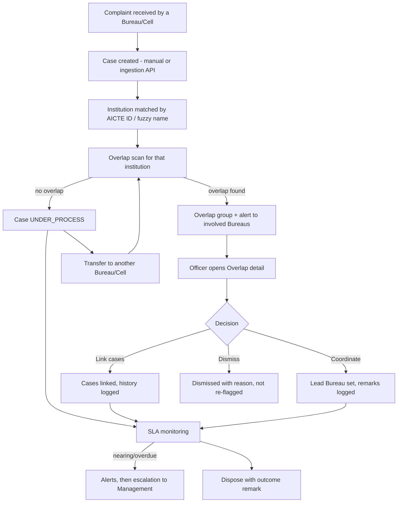

# 03 — APP FLOW

## 1. Site map (max 6 sidebar items)
```
/login
/ (Overview)
/cases  → /cases/new , /cases/[id]
/overlaps → /overlaps/[id]
/institutions → /institutions/[id]
/reports
(top bar) 🔔 Alerts → /alerts      (user menu) Audit trail (Management), Settings (Management)
```

## 2. Core lifecycle


## 3. Flow A — Management morning check
Login → **Overview**: 4 KPIs (Open cases · Overlaps needing coordination · Overdue · Disposed this month) → "Needs attention" list (top 5: overlaps first, then most overdue) → click an item → case or overlap detail. Bureau workload chart is secondary.

## 4. Flow B — Case creation (Bureau Officer)
Cases → "New case" → single-page form (Institution search by name/AICTE ID, Category, Source, Subject, Description, Received date) → Save → case ID generated, SLA date computed → if overlap found, banner appears on the new case: "Potential Overlapping Cases – Coordination Required [View]".

## 5. Flow C — Case detail
Header: Case ID, institution, status chip, current Bureau/Cell + officer. Left: details (category, received, last action, next action, expected disposal). Right: **Related / overlapping cases** panel (only if any). Below: **timeline** (chronological actions with officer, bureau, time, remarks). Action bar: Add remark · Update status · Transfer · Escalate · Dispose (primary action = context-dependent).

## 6. Flow D — Overlap coordination
Overlaps list (open first) → open group → side-by-side cards for each case (bureau, status, last action, category) + "Why flagged" chips (Same institution · Different Bureaus · Similar category · Similar wording · Within 90 days) + score badge (Strong / Possible) → actions: **Link cases**, **Mark coordinated** (choose lead Bureau + remark), **Dismiss** (reason required). Result written to every involved case timeline; alerts cleared.

## 7. Flow E — Transfer
Case detail → Transfer → choose target Bureau/Cell + reason → confirm → case moves, timeline shows "RB → PGRC", overlap scan re-runs, target bureau alerted.

## 8. Flow F — Alerts & SLA
Management "Run scan now" (or automatic) → bell badge → Alerts page (simple list, filter: unread/all) → click → case. Escalations appear only for Management.

## 9. Flow G — Reports
Reports → choose one of 5 report cards → preview table + tiny chart → Export CSV.

## 10. Flow H — Institution profile
Institutions → search → profile: header (AICTE ID, name, region), "Open cases by Bureau" mini bars, overlap flag, consolidated case history table.

## 11. Navigation rules
Unauthenticated → `/login`. Role-scoped data only. Filters persist in URL query. Breadcrumbs on detail pages. Back keeps filters.

## 12. Empty / error states
| Screen | Empty | Error |
|---|---|---|
| Overview "Needs attention" | "Nothing needs attention right now" | Retry |
| Cases | "No cases match. Clear filters" | Retry |
| Overlaps | "No overlapping cases detected" | Retry |
| Alerts | "You're all caught up" | Retry |
